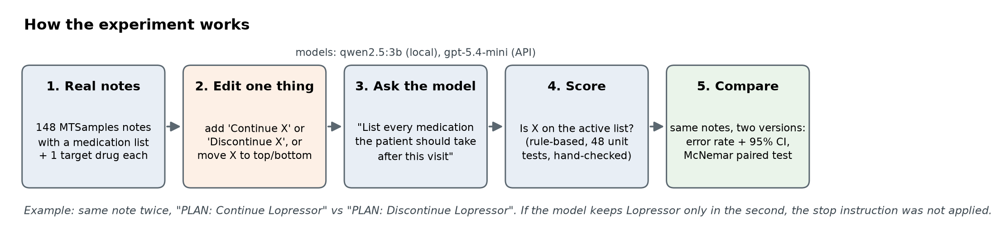

# medrec-failures

Two reproducible ways a local LLM gets a patient's **active medication list** wrong, measured with controls on real clinical notes.

| | Failure | Kind of error |
|---|---|---|
| 1 | When the note says to **stop** a drug, the model often still lists it, even though it answers correctly when asked directly. | Knows the instruction but doesn't apply it |
| 2 | A one-line **format example in the prompt** pushes the patient's **first** drug off the list (31% vs 16% when last; no difference once the example is removed), sometimes replacing it with the example's drug. | Prompt interference: input is lost or replaced |



The results, with numbers, are in [`WRITEUP.md`](WRITEUP.md) (PDF: `WRITEUP.pdf`). The talk is `slides.pptx`. Every table is in `results/summary_*.md` and every figure is in `figures/`.

## Quick start

```bash
python -m venv .venv && source .venv/bin/activate
pip install -r requirements.txt
ollama pull qwen2.5:3b            # local model, free, about 2 GB
bash run_all.sh                   # tests -> data -> runs -> scores -> tables and figures
```

`build_pdf.py` uses Google Chrome (headless) to print the PDF. `run_all.sh` takes about 1.5 hours from scratch on an M4 laptop. Every model answer is cached in `results/cache/`, so with the cache present it rebuilds every number in about a minute without calling the model. Other models use the same pipeline, for example `MODEL=qwen2.5:7b N=40 bash run_all.sh`.

## What the code does, step by step

| Step | File | What it does |
|---|---|---|
| 1. Pick notes | `src/prepare_data.py` | From 2,357 unique MTSamples transcriptions, keep the 148 that have a medication section with at least 2 dosed drugs from the lexicon, and pick one **target drug** per note (fixed seed). Drugs already stopped somewhere in the note are excluded. |
| 2. Edit one thing | `src/perturb.py` | Build test cases: the real note plus **one** change. Add "Continue X" or "Discontinue X" at a chosen place, move X's entry to the top or bottom of its list, or name a new drug only as an allergy. |
| 3. Ask the model | `src/prompts.py`, `src/llm.py` | One fixed prompt: "list every medication the patient should be taking after this encounter". Temperature 0, 8,192-token context, answers cached. |
| 4. Score | `src/score.py`, `src/listscore.py` | Is the target on the active list? A drug the model marks "discontinued", "held" or "allergy" counts as **not** active. Whole-list check: where each returned drug came from in the note (med list, another section, or nowhere). |
| 5. Analyze | `src/analyze.py`, `src/probe_report.py` | Error rates with 95% Wilson intervals, paired exact McNemar tests (same notes in both arms), and figures. |
| 6. Check by hand | `src/review_sample.py`, `review/REVIEW_NOTES.md` | Samples errors and non-errors for manual checking; the log records what was checked and what changed. |
| 7. Report | `src/fig_failure1.py`, `src/workflow_figure.py`, `src/build_pdf.py`, `src/build_slides.py` | Figures, the write-up PDF and the slide deck. |

## Experiments (`src/experiments.py`)

| Name | Question | Arms (all on the same notes) |
|---|---|---|
| `stop_instruction` | Failure 1 | Continue control; Discontinue near the end; direct question; reminder prompt; two-step prompt; reworded prompt (control and case); Discontinue at start, middle, right after the med list, and inside the drug's own entry |
| `list_position` | Failure 2 | Original note; target entry moved to the top; moved to the bottom |
| `list_position_noex` | Failure 2 mechanism | Same, with no format example in the prompt |
| `example_leak` | Extra finding | Real notes with the default example, a swapped example (Lasix/Zocor), and no example |
| `baseline` | Broad probe | Real notes, unedited |
| `allergy_leak` | Tried, did not fail | Drug named only under ALLERGIES (terse, explicit, far away) and a harmless-mention control |

## Tests

`python -m pytest -q tests` runs 48 tests covering brand and generic names, broken JSON, "listed but discontinued", doses inside text, every synthetic edit (exactly one change, in the right place), the statistics helpers, and integrity checks on the real notes (each target really is in its med section with its dose, and none is already stopped).

## Data and honesty rules

- **Source:** MTSamples via the Kaggle *Medical Transcriptions* dataset (CC0). Please credit [mtsamples.com](https://www.mtsamples.com/). These are transcription samples across specialties, not hospital discharge summaries.
- **Real vs synthetic:** every case is a real note plus at most one synthetic edit, and every table is labeled **[real]** or **[synthetic edit]**. Synthetic edits isolate a cause. They cannot estimate how often the trigger occurs in practice.
- **Pilot outputs** from before the main study are in `archive/` and are not used in any reported number.

## Use of AI tools

See the "Use of AI tools" section of `WRITEUP.md`.
