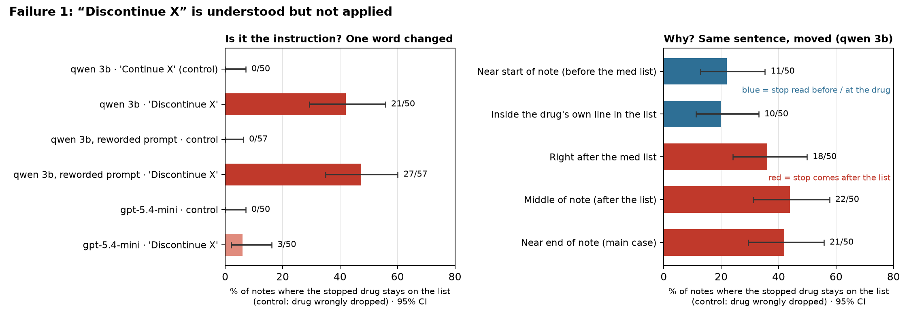
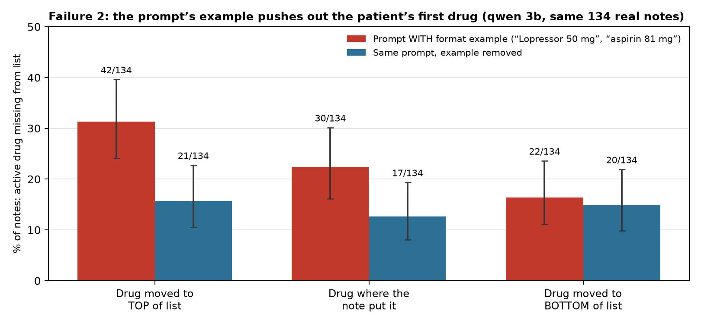

# Two ways a small LLM gets a patient's medication list wrong

**Himani Shah · Alterra Labs Applied Research take-home · October 2026**

## What I tested

**Task.** Medication reconciliation. The model reads a clinical note and returns the patient's *active* medication list after the visit. That list feeds refills, orders and the next clinician's view of the patient, so mistakes carry forward.

**Model.** `qwen2.5:3b` instruct (3.1B parameters, Q4_K_M, Ollama 0.35.1), temperature 0, 8,192-token context, JSON output. I chose a small open model because it runs on a laptop, which is a realistic option for a clinic that cannot send notes to an outside API. To see which failures are about model size, I re-ran the key tests on **`gpt-5.4-mini`** (OpenAI API, temperature 0, 27 Oct 2026).

**Data.** MTSamples transcribed notes (Kaggle *Medical Transcriptions*, CC0; credit mtsamples.com). Of 2,357 unique notes, I kept the 148 whose medication section lists at least two dosed drugs from a hand-checked 80-drug lexicon. For each note I picked one **target drug** with a fixed seed, never one already stopped elsewhere in the note. Each test case is the real note plus **one** controlled change. I label results **[real]** for unedited notes and **[synthetic edit]** for edited ones.

**Scope.** These are controlled tests on transcribed MTSamples notes with one synthetic edit each, not an evaluation on real discharge summaries. They show *what causes* each error, not how often it happens in a hospital.

**Scoring.** Rule-based, with 48 unit tests. The target counts as *active* if it is in the returned list and not marked "discontinued", "held" or "allergy" (a kept-but-marked drug is *not* counted as an error). I report rates per note with 95% Wilson intervals. When two versions run on the same notes, I compare them with an exact McNemar test, which looks only at notes where the two versions disagree. I read every main-case error by hand ([review log](review/REVIEW_NOTES.md)).

## Failure 1: the model understands "discontinue" but doesn't apply it

> **When a note says to stop a drug, qwen2.5:3b still lists it as active in 42% of notes (21/50), while the matched "continue" control is wrong 0/50 times. In 16 of those 21 failures, the model answers "no" when asked directly whether the patient should still take the drug.**

**Setup [synthetic edit].** I add one line to a real note, `PLAN: Discontinue <drug>.`, near the end of the note. The control adds `PLAN: Continue <drug> at the current dose.` in the same place. Rates are among the 50 of 60 notes where the model listed the drug correctly in the control, so it clearly saw the drug.

**Evidence.**

| qwen2.5:3b, same 50 notes | Stopped drug still listed |
|---|---|
| Control: "Continue X" (error = drug dropped) | 0/50 (0%, CI 0–7%) |
| **"Discontinue X" near end** | **21/50 (42%, CI 29–56%)** |
| Same, plus "check the whole note for stops" in the prompt | 16/50 (32%), p = 0.13 vs default |
| Reworded prompt, no format example (own control 0/57) | 27/57 (47%) |
| Direct question "should the patient still take X?" (error = says yes) | 7/50 (14%) |

Example (`mts_3403`): the plan says *Discontinue Coumadin*, and the model returns `Coumadin 5 mg` on the active list. Asked directly, it answers "no" and quotes the plan line.

**It also happens in a much stronger model.** gpt-5.4-mini keeps the stopped drug in 3/50 notes (6%, CI 2–16%), and in 6/50 (12%) when the instruction is near the start, while answering the direct question correctly 50/50 times. The rate is lower, but the same "knows it, doesn't apply it" pattern appears.

**Checks.** (a) qwen sometimes copies drugs from the prompt's format example (Lopressor, aspirin; see Failure 2). Without targets that are metoprolol or aspirin, the result is control 0/40 and discontinue 15/40 (38%). (b) Without the 2 notes that list the drug twice (admission and discharge lists), it is 19/48 (40%). (c) A differently worded prompt with no format example gives the same picture: control 0/57, discontinue 27/57 (47%). So the failure doesn't depend on one phrasing or on the example.

**Why: my hypothesis and how I tested it.** *Writing the list is mostly copying the medication section. A stop instruction has to override that copy, and it only does so reliably when the model meets it before or at the drug's line, not when it comes later in the note.*

1. **Understanding vs applying.** In 16 of 21 failures the direct question is answered correctly, so the model can find and interpret the instruction. The failure is in using it while writing the list.
2. **Where the instruction sits.** The medication section is about 35–45% of the way into a typical note. I moved the identical sentence around:

    - **before the list** (10% into the note): 11/50 (22%), p = 0.013 vs end of note
    - **inside the drug's own line** (`Coumadin 5 mg (PLAN: Discontinue Coumadin.)`): 10/50 (20%), p = 0.003
    - **anywhere after the list**: right after it 18/50 (36%), middle 22/50 (44%), end 21/50 (42%)

    Errors drop only when the instruction comes before the list or is attached to the drug's line. Moving it around after the list makes no difference.

3. **The model contradicts itself in one answer.** I asked the model to *first copy every stop sentence, then list the active drugs*. This prompt never names the drug. It did not help (18/50, 36%; p = 0.63 vs default). In **11 of those 18 failures the model wrote "Discontinue X" in step 1 and still listed X in step 2 of the same answer.** Finding the instruction is not the problem. Applying it to the list is.

**Clinical relevance.** A drug stopped at a visit that stays on the reconciled list can be refilled or re-ordered. One failing case is warfarin (bleeding risk), and others are beta-blockers and antihypertensives (hypotension, falls). These are synthetic instructions on real notes, so I am not estimating how often this happens in practice. The rate here is conditional on a stop instruction being present.

## Failure 2: a format example in the prompt pushes the patient's first drug off the list

> **With a one-line format example in the prompt, qwen2.5:3b leaves the first drug of a medication list off the output in 31% of notes (42/134), against 16% when the same drug is last (22/134, p = 0.003). Sometimes it writes the example's drug in its place. Removing the example removes the effect (16% vs 15%).**

**Why this matters as a deployment failure.** Putting a short output example in the prompt is standard practice. Mine was `Example: {"medications": ["Lopressor 50 mg", "aspirin 81 mg"]}`. Nothing about it looks risky, yet it silently changes which of the patient's drugs survive.

**Setup.** *[real]:* 148 unedited notes. *[synthetic edit]:* I move the target drug's own entry, word for word, to the top or the bottom of its list. Nothing else changes (134 notes whose lists split cleanly). Error = the target drug is missing from the output.

**Evidence.**

| qwen2.5:3b, same 134 notes | Prompt with example | Example removed |
|---|---|---|
| Drug moved to the top of the list | **42/134 (31%, CI 24–40%)** | 21/134 (16%) |
| Drug where the note put it [real] | 30/134 (22%) | 17/134 (13%) |
| Drug moved to the bottom | 22/134 (16%) | 20/134 (15%) |
| Top vs bottom (paired McNemar) | 31 vs 11 notes, **p = 0.003** | 15 vs 14 notes, p = 1.0 |

Example (`mts_3291`): the list starts "Medications are Glipizide 10 mg p.o. q day…". The model's list starts "Lopressor 50 mg b.i.d." (the example's drug, never mentioned in the note), and Glipizide is gone. In 9 of the 42 top-of-list drops, the first item of the answer was an invented example drug like this.

**Why: my first guess was wrong.** I expected drugs at the *bottom* of long lists to be lost (running out of attention). The data showed the opposite, and the outputs showed where to look: the first slot was being taken by the example.

*Hypothesis: the model treats the format example as the start of the answer, so the example's items compete with the patient's first item for the opening slot.* Tests:

1. **Remove the example, change nothing else.** The top-of-list drop goes from 42 to 21 notes. Paired on the same notes, 27 drugs are lost only with the example and 6 only without it (p = 0.0003). Bottom-of-list drops don't change (7 vs 5, p = 0.77). The extra loss sits exactly at the first slot.
2. **[real] Unedited notes, all lexicon drugs.** Drugs in the first third of a list are omitted most (75/284, 26%), against 13% (middle) and 19% (last third).
3. **[real] Change only the example, on all 148 unedited notes.** With the Lopressor/aspirin example, 15/148 outputs (10%) contain a drug that appears nowhere in the note (metoprolol 15 times, aspirin 7). With no example: 0/148 (paired p = 0.00006). With a Lasix/Zocor example: 2/148, and neither was Lasix or Zocor. So the example clearly causes the invented drugs, but *which* drugs get copied depends on the example. Common cardiac drugs that fit these patients were copied, and Lasix/Zocor were not. The default example also raises how often the target is missing (34/148, against 22/148 with no example and 21/148 with Lasix/Zocor).
4. **Model size.** gpt-5.4-mini, with the same example, drops the target 0/58 times at any position and never invented an example drug.

**What remains without the example.** The model still misses an active drug about 13–16% of the time wherever it sits. That baseline omission is real, but it isn't position-specific. I report it as a limitation, not as part of this failure.

**How this differs from Failure 1.** Failure 1 comes from *the note*: the model reads an instruction and doesn't apply it, so a stopped drug stays. Failure 2 comes from *the prompt*: no instruction is involved, and a format example pushes out the patient's own first drug. They respond to different fixes. Removing the example erases Failure 2 (top vs bottom p = 1.0), while Failure 1 stays at 47% with a reworded prompt that has no example. Moving the stop sentence before the list helps Failure 1 and has nothing to do with Failure 2. They also split across models (Failure 1 appears in gpt-5.4-mini, Failure 2 does not).

**Clinical relevance.** Unintended omission is the most commonly reported medication-reconciliation discrepancy in hospital audits. A dropped anticoagulant, insulin or antiepileptic at discharge is an unplanned stop. An invented drug, such as a beta-blocker the patient never took, is a commission error that could be continued downstream. The fix is cheap (drop the example, or check that every output drug appears in the note), but only if someone knows to look.

## What I tried that did not turn up a failure

| Hypothesis | Test | Result |
|---|---|---|
| A drug named only under ALLERGIES leaks onto the active list | Replaced the real allergy section with `ALLERGIES: <drug>.` (a drug absent elsewhere in the note); terse vs explicit wording, near vs far, and a harmless-mention control | gpt-5.4-mini: 0/20 in every version (not re-run on qwen 3b for time; the real-note check below covers qwen). **No failure.** |
| [real] Real allergens appear as active drugs (qwen 3b) | All 51 unedited notes with a drug allergy | 0/51 after checking by hand (2 automatic hits were drugs also on the medication list) |
| A "check for stops" reminder, or a two-step prompt, fixes Failure 1 | Same notes, prompt changed | Reminder 42% to 32% (p = 0.13), two-step 36% (p = 0.63): neither is a reliable fix |
| Failure 2 in a stronger model | Same top/bottom test on gpt-5.4-mini | 0/58 dropped. **No failure.** |

**Bugs I found and fixed before the final runs.** Ollama's default 4,096-token context silently cut long prompts, so all runs use 8,192. The allergy test could pick a drug already in the note under a brand name (naproxen vs Aleve), and a unit test now prevents this. Pilot outputs from before these fixes are archived and not used.

## Limitations

- **Synthetic edits show cause, not frequency.** Failure 1's rate is conditional on a stop instruction being present. Failure 2's real-note rate comes from MTSamples, which mixes specialties and is not a discharge cohort. Neither gives a hospital prevalence.
- **Models.** One small open model plus one API model whose version can change. Exact settings are in the repo.
- **Scoring.** Matching uses an 80-drug lexicon plus string matching. Target-drug results depend on one known drug per note. Whole-list counts are a screen. I read every Failure 1 error by hand and fuzzy-checked all 577 "removed" outputs for misspellings (0 found).
- **Baseline omission.** Even without the example, qwen 3b misses an active drug in about 13–16% of notes. I don't explain that part.
- **Sample size.** 50–134 notes per test gives intervals about ±13 points wide. The main contrasts are large enough to be clear, but the smaller differences (for example, reminder vs default) are not.

## What I would do next

1. **Real discharge data.** Run on MIMIC-IV discharge summaries (PhysioNet access) to measure how often stop instructions and long lists actually occur.
2. **Turn failures into eval items.** For example, "every stop instruction is applied" and "every listed active drug is kept", scored against a clinician-written reference, plus a check that the output has no drugs absent from the note.
3. **Mechanism.** Look at attention or attribution in the open model during list writing, and run the position tests across a size ladder (3B, 7B, 14B).

## Use of AI tools

I used Claude (Anthropic) as a coding and writing assistant. It helped refactor the harness, write the scorer, tests and analysis scripts, do a first pass over error cases, and draft this write-up and the slides. An earlier pilot used OpenAI Codex. I reviewed the design and every number, and `bash run_all.sh` regenerates all tables and figures from the cached model outputs. The models *being tested* were qwen2.5:3b (local) and gpt-5.4-mini (API). No model was used to score outputs. All scoring is rule-based and unit-tested.

---

# Appendix

[[APPENDIX]]
